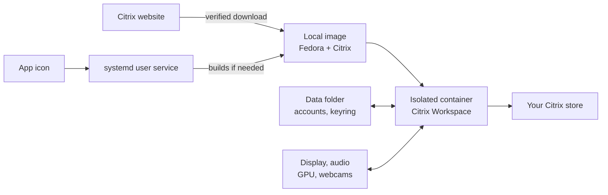

# Citrix Workspace (contained)

Runs the official Citrix Workspace app for Linux in a rootless Podman container, managed by systemd
through a Quadlet unit. Work stays separate from the rest of the computer: Citrix sees only its own
data folder and the display, audio, GPU and webcams it needs, and the whole thing can be removed with
one command.

It suits personal or shared Linux machines where work software must not mix with private data.
The Fedora image supplies current graphics and media libraries independently of the host distribution;
the GPU kernel driver still comes from the host.

## How it works



- **Image:** Citrix's official amd64 Debian payload on the latest stable Fedora container image, with
  Mesa graphics, VA-API and Vulkan drivers, plus the libraries Citrix needs. The Debian build uses
  Fedora's WebKitGTK 4.1; the package is extracted without installing a Debian package manager into
  the runtime image. It is built on your machine and never published.
- **Updates:** on every start, the Citrix download page is checked. A new release is downloaded only
  when its version differs from the installed one, accepted only if its SHA-256 is published on that
  page, and built into a fresh image. The image is also rebuilt weekly for Fedora updates. A change of base image also triggers a rebuild.
- **Service:** a Quadlet unit runs the container as `citrix-workspace.service` in your user's
  systemd. It belongs to your desktop session and stops when you log out.
- **Lifetime:** the container stays up while the Workspace window or a session is open, then exits.

## Requirements

- Podman 5 or newer, rootless, with Quadlet (included with Podman on RHEL, AlmaLinux and Rocky 9.5+
  and 10, and on Fedora)
- A graphical session with X11 or Xwayland (GNOME on Wayland qualifies), and PipeWire or PulseAudio
- `git`, `curl`, `make`, and about 2 GB of disk space for the image

## Install

Read the
[Citrix End User Agreement](https://www.cloud.com/content/dam/cloud/documents/legal/end-user-agreement.pdf)
first; it applies whenever Citrix software is downloaded. The last two lines record that you accept it.

```sh
git clone https://github.com/enoch85/citrix-workspace-contained.git
cd citrix-workspace-contained
make install
mkdir -p ~/.config/citrix-workspace
echo ACCEPT_CITRIX_EULA=yes >> ~/.config/citrix-workspace/config
```

This adds **Citrix Workspace (contained)** to your applications, with this icon:


To install for every user on a machine, run
`sudo make install PREFIX=/usr/local QUADLETDIR=/etc/containers/systemd/users`.
Each user still keeps their own image, settings and accounts.

## Use

Click the **Citrix Workspace (contained)** icon. You can pin it to your dock; its right-click menu has
**Check for Updates** and **Stop Citrix Workspace**.

The first start takes a few minutes, and notifications tell you how it's going, or why it couldn't start:

1. Citrix is downloaded.
2. The image is built, and you're told when it's ready.
3. You choose a password for the **Citrix Workspace** keyring, which keeps your sign-in encrypted in
   the data folder.
4. The window opens and asks for your account. Enter your store address (for example
   `yourcompany.cloud.com`).

Later starts open the window straight away, unless a new Citrix release or the weekly refresh rebuilds
the image first.

| Command | What it does |
| --- | --- |
| `citrix-workspace` or `citrix-workspace start` | Start, or reopen the window if you closed it during a session. Extra clicks on the icon are safe. |
| `citrix-workspace stop` | Stop Citrix and any open sessions |
| `citrix-workspace status` | Installed version and service state |
| `citrix-workspace logs -f` | Follow the log (systemd journal) |
| `citrix-workspace update [--force]` | Check for a new release now, or rebuild regardless |
| `citrix-workspace purge` | Delete the image, settings, accounts, cache and downloads |

## Configuration

Optional settings in `~/.config/citrix-workspace/config`, or as environment variables (for example in
a systemd drop-in for managed machines); the config file takes precedence:

| Setting | Default | Meaning |
| --- | --- | --- |
| `ACCEPT_CITRIX_EULA` | `no` | Must be `yes` to download from Citrix |
| `CITRIX_DEB` | empty | Path to an approved `icaclient_<version>_amd64.deb`. Pins that version and skips the Citrix website; for managed fleets or offline use. |
| `REFRESH_DAYS` | `7` | Rebuild at least this often for operating-system security updates |
| `CITRIX_PAGE` | Citrix's Linux download page | Where to look for new releases |

## Security model

What the container can reach:

- `~/.local/state/citrix-workspace` (its home folder: settings, accounts, logs)
- The X11 display, through Xwayland on Wayland desktops
- Audio, through the PipeWire or PulseAudio socket
- The GPU (`/dev/dri`) and webcams (`/dev/video0` to `3`), when present
- The network

Everything else in your home folder, your browser and your other applications is outside its view. It
runs as your user with every Linux capability dropped and no way to gain privileges. The root-level
services the official package normally installs, such as USB redirection, never run on the host.

The following trade-offs come with running a graphical app this way, and are listed so you can judge
them:

- **X11:** an X11 client can read input and screen contents of other X11 clients. On a Wayland
  desktop that is limited to other Xwayland apps.
- **Shared IPC (`--ipc=host`):** needed for X11 shared memory, without which drawing is slow or fails.
- **SELinux label separation off:** needed to reach the X11 and audio sockets. User namespaces and
  dropped capabilities still apply.
- **Updates:** they come straight from Citrix's website over HTTPS and are refused unless Citrix
  publishes the file's SHA-256. To control versions centrally, use `CITRIX_DEB`.

## Troubleshooting

- `citrix-workspace logs -e` shows the latest output. On RHEL-family systems, where the journal
  isn't split per user, this needs membership of the `wheel` or `adm` group. Citrix's own detailed
  logs are in `~/.local/state/citrix-workspace/.ICAClient/logs/`.
- These messages are harmless: `Failed to open /etc/systeminfo`, `/etc/tzagent/info`,
  `System has not been booted with systemd`, `Failed to connect to system scope bus`,
  `canberra-gtk-module`, `pk-gtk-module`, `gssapi step failed`.
- *"The Authentication Service could not be contacted"* after entering an email address means email
  discovery led to a server that refused the connection. Enter the store address instead.
- **No microphone in Teams:** run `pactl get-default-source`. If the name ends in `.monitor`, your
  computer has no usable microphone input, and Teams in the session finds none. On Intel laptops with a
  digital microphone (`DMIC` in `/proc/asound/pcm`), installing `alsa-ucm` can make it appear, as it did
  on a Dell XPS 13 9310. Stop Citrix first, then install it and run
  `systemctl --user restart wireplumber pipewire pipewire-pulse`.
- To start over with a clean setup, run `citrix-workspace purge`, then start again.

## Uninstall

```sh
make uninstall
```

This stops Citrix and removes the program, image, settings, accounts, cache and downloaded packages.
Use the same `PREFIX` and `QUADLETDIR` you installed with.

## Disclaimer

This project is not affiliated with or endorsed by Citrix. It contains no Citrix software; the
Citrix Workspace app is downloaded from Citrix by each user, under Citrix's license terms. Citrix and
Citrix Workspace are trademarks of Citrix Systems, Inc. and/or its affiliates.

Licensed under the MIT License (see `LICENSE`).
